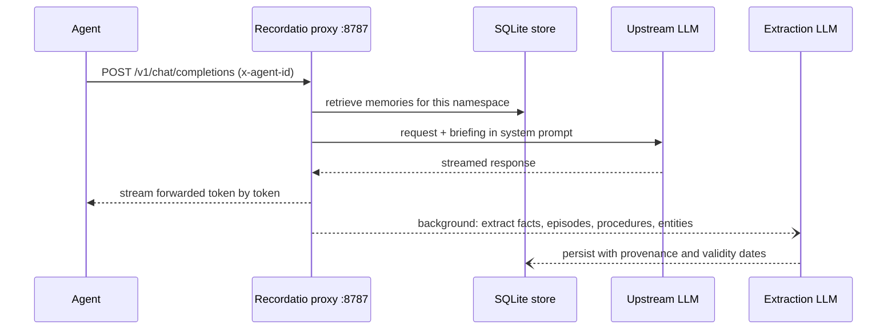
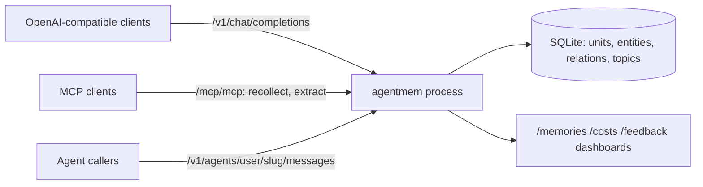

# Recordatio

Recordatio is a long-term memory layer for LLM agents. It runs as an
OpenAI-compatible proxy (plus an MCP server): it injects relevant memories into
each request and extracts new ones from each turn, so agent code needs no
memory calls. It is for people running their own agents who want memory to work
without changing agent code.



The package (`src/tpasini/recordatio/`) also exposes MCP tools, a hosted agent
runtime and a few dashboards. All of them share the same store:



## Quickstart

Requires Python 3.13.

```bash
git clone https://github.com/pasinit/recordatio && cd recordatio
python3.13 -m venv .venv
.venv/bin/pip install pip-tools
make install
echo 'RECORDATIO_EXTRACTION_MODEL=anthropic/claude-haiku-4-5-20251001' > .env
make run                      # same as: agentmem --port 8787
```

> One runtime dependency, a provider-routing library, is installed from a
> private Git repository (see `requirements.in`). A fresh install fails without
> access to it.

Point an OpenAI-compatible client at the proxy and pick a memory namespace:

```python
from openai import OpenAI
client = OpenAI(base_url="http://localhost:8787/v1")
client.chat.completions.create(
    model="anthropic/claude-opus-4-6",
    messages=[{"role": "user", "content": "Hi"}],
    extra_headers={"x-agent-id": "my-agent"},
)
```

The client's `Authorization: Bearer` token is forwarded upstream.

## Model routing

The `model` field uses `provider/model`. The prefix picks the backend:

| Prefix | Backend | Default base URL |
|--------|---------|------------------|
| `anthropic/` | Anthropic | Anthropic default |
| `openai/` or no prefix | OpenAI-compatible | OpenAI default |
| `ollama/` | OpenAI-compatible | `http://localhost:11434/v1` |
| `lmstudio/` | OpenAI-compatible | `http://localhost:1234/v1` |
| `gemini/` | OpenAI-compatible | Google's OpenAI-compatible endpoint |
| `codex/` | Codex CLI (ChatGPT subscription), extraction only | none |

## Request controls

Recordatio strips these before forwarding upstream.

| Field | Where | Effect |
|-------|-------|--------|
| `x-agent-id` | header | Memory namespace. Briefing and extraction only run when it is set. |
| `x-recordatio-source-agent-id` | header | Provenance label inside a shared namespace (defaults to `x-agent-id`). |
| `x-recordatio-no-briefing` | body | `true` skips memory injection. |
| `x-recordatio-skip-input-extraction` | body | `true` skips mining the user message, for example for scheduled triggers. |
| `x-recordatio-skip-output-extraction` | body | `true` skips mining the assistant reply. |
| `x-recordatio-extract-from` | body | Overrides what is sent to the extractor (`{"last_user_message": ...}`). |

When memories are recalled, a streamed response begins with a named SSE event,
`event: agentmem.briefing`, that lists the recalled units, entities and
relations. Standard clients ignore it.

## MCP

The same process serves MCP (Streamable HTTP) at `http://localhost:8787/mcp/mcp`
with two tools: `recollect(query)` and `extract(messages, response_text,
background=False)`. The namespace comes from the `X-Agent-Id` header the client
operator configures, never from a tool argument:

```json
{"mcpServers": {"recordatio": {"type": "http", "url": "http://localhost:8787/mcp/mcp",
  "headers": {"X-Agent-Id": "my-agent"}}}}
```

Optional headers: `X-Recordatio-Api-Key` (extraction key override) and
`X-User-Id` (tags cost-log rows).

## HTTP routes

| Route | Purpose |
|-------|---------|
| `POST /v1/chat/completions` | Proxy with briefing and extraction |
| `POST /v1/agents/{user_id}/{slug}/messages` | Run a hosted agent (Claude Agent SDK or Codex subscription), streamed as SSE |
| `GET/PUT /v1/agents/{user_id}/{slug}/config` | Hosted agent configuration |
| `GET /v1/users/{user_id}/memory-search`, `/units`, `/memory-feedback` | Memory search and user feedback |
| `GET /v1/briefing-events[/{request_id}]` | What was injected, per request |
| `GET /memories`, `/costs`, `/feedback` | Dashboards (knowledge graph, extraction cost, feedback review) |
| `GET /health` | Liveness check |

## Configuration

Set environment variables, or put them in `.env`. `make run` loads that file.

| Variable | Default | Purpose |
|----------|---------|---------|
| `RECORDATIO_EXTRACTION_MODEL` | required | Extraction model, `provider/model` |
| `RECORDATIO_EXTRACTION_API_KEY` | request bearer token | Key for the extraction provider when it differs from upstream |
| `AGENTMEM_DB` | `~/.agentmem/memories.db` | SQLite store path |
| `RECORDATIO_SUBSCRIPTION_PROVIDER` | `claude` | Hosted agent runtime: `claude` or `codex` (see [CODEX_MIGRATION.md](CODEX_MIGRATION.md)) |
| `RECORDATIO_MCP_ALLOWED_HOSTS` | loopback, `recordatio:8787` | JSON array of trusted `Host` values for MCP |
| `RECORDATIO_RESTRICTED_NETWORKS`, `RECORDATIO_RECALL_KEY_SHA256` | empty | JSON arrays. Callers from these CIDRs need a recall key, which can only call `memory-search`. |
| `OTEL_EXPORTER_OTLP_ENDPOINT` | empty (off) | OpenTelemetry OTLP/gRPC endpoint |
| `OTEL_SERVICE_NAME` | `recordatio` | Trace service name |

Retrieval and briefing tuning knobs (`RECORDATIO_BRIEFING_*`,
`RECORDATIO_RETRIEVAL_*`, `RECORDATIO_RERANK_*`) are documented where they are
read, in `src/tpasini/recordatio/proxy/`.

To backfill an existing store into the ontology tables, run
`agentmem-backfill --db <path> --agent-id <id>`. It is a dry run by default.
Pass `--apply --enable-ontology-apply` to write; this takes a backup first.

## Knowledge model

| Type | What | Example |
|------|------|---------|
| Semantic | Durable facts | "The project targets Python 3.13" |
| Episodic | Specific events | "Compared two reports and found three changes" |
| Procedural | Learned strategies | "Check the cache before re-fetching filings" |

Every unit carries `asserted_at`, `valid_from` and `valid_until`. Superseded
facts are invalidated, not deleted. Retrieval depends on the request, so each
briefing is built from the current task rather than dumped wholesale.

## Development

```bash
make install    # pip install -r requirements-dev.txt -e .
make test       # pytest
make lint       # ruff check
make fix-lint   # ruff --fix + ruff format
make compile    # re-pin requirements after editing *.in
```

A `Dockerfile` is included. It serves on port 8787 and needs a `GITHUB_TOKEN`
build arg for the private dependency.

## License

Apache-2.0
