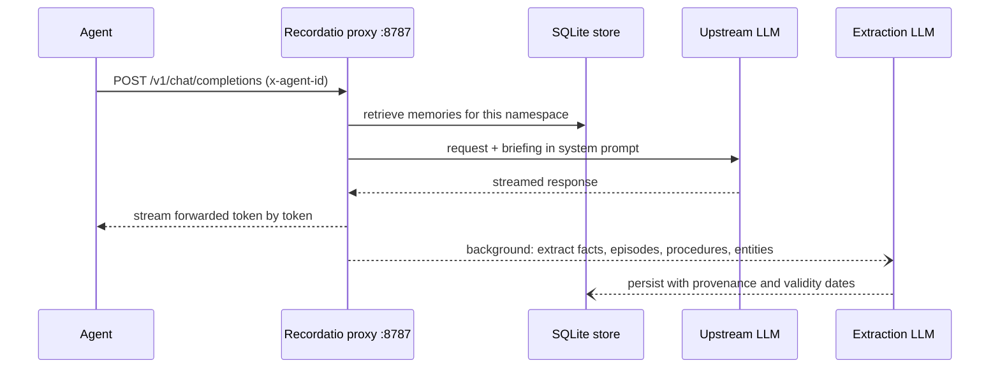
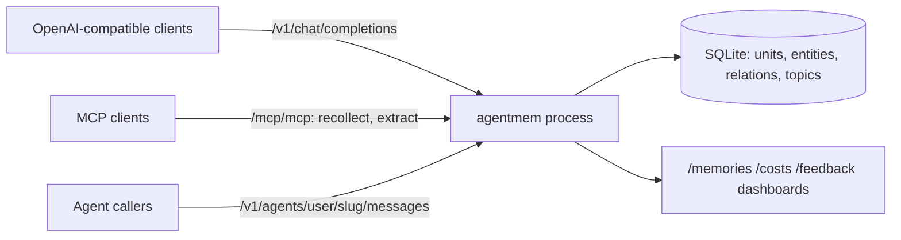

# Recordatio

**Long-term memory for LLM agents, without changing agent code.**

Recordatio sits between your agent and its model as an OpenAI-compatible proxy. On each request it adds what the agent should remember to the prompt. After each turn it extracts what is worth remembering: facts, events, strategies, people and things. The agent keeps calling `/v1/chat/completions` as before; memory just happens. The same memory is also available as MCP tools.

## Why it exists

Agents forget everything between sessions. The usual fixes all have costs:

- **Stuffing history into the prompt** grows without bound and buries what matters.
- **Memory tools the agent must call** depend on the model remembering to call them, and need changes to every agent.
- **A vector store of raw chat** recalls text, not knowledge. It can't tell a fact that changed from one that still holds.

Recordatio's answer:

| Problem | What Recordatio does |
|---|---|
| Unbounded context | Each request gets a **briefing** built for that request, within a token budget, not a dump of everything. |
| Agents must opt in | It works at the **proxy** level, so any OpenAI-compatible client gets memory by setting a header. |
| Raw text, not knowledge | Each turn is **extracted** into typed units (semantic, episodic, procedural), entities and relations, with provenance. |
| Stale facts | Every unit has validity dates. A superseded fact is **invalidated, not deleted**, so you can see what was true when. |

## What it looks like

Point any OpenAI-compatible client at Recordatio and give the agent a memory namespace:

```python
from openai import OpenAI
client = OpenAI(base_url="http://localhost:8787/v1")

def ask(text):
    return client.chat.completions.create(
        model="anthropic/claude-opus-4-6",
        messages=[{"role": "user", "content": text}],
        extra_headers={"x-agent-id": "my-agent"},
    )

ask("We moved the release to Thursday, and the build needs Python 3.13.")
# ... later, in a brand-new conversation:
ask("When is the release, and what Python do I need?")
```

After the first turn, Recordatio extracts facts in the background ("the release is on Thursday", "the build needs Python 3.13"). On the second request it recalls them and adds a `<user_profile>` and `<relevant_memory>` briefing to the system prompt before forwarding. The model answers from memory, with no memory code in the agent.



## Try it

You need Python 3.13.

```bash
git clone https://github.com/pasinit/recordatio && cd recordatio
python3.13 -m venv .venv
.venv/bin/pip install pip-tools
make install
echo 'RECORDATIO_EXTRACTION_MODEL=anthropic/claude-haiku-4-5-20251001' > .env
make run                      # same as: agentmem --port 8787
```

Then run the example above. Your client's `Authorization: Bearer` token is forwarded upstream. Open `http://localhost:8787/memories` to browse what was extracted.

> One runtime dependency, a provider-routing library, is installed from a
> private Git repository (see `requirements.in`). A fresh install fails without
> access to it.

## How it's built

One process (`agentmem`) serves the proxy, the MCP tools, a hosted agent runtime and a few dashboards, all over one SQLite store:



- **Briefing.** Candidates are retrieved and reranked for the current request, then fitted into a token budget.
- **Extraction.** It runs in the background after the response has streamed, so it adds no latency to the agent.
- **Model routing.** `provider/model` picks the backend (Anthropic, OpenAI-compatible, Ollama, LM Studio, Gemini), for both the agent's requests and extraction.

The code is in `src/tpasini/recordatio/`:
- `proxy`: the HTTP routes, briefing, retrieval and MCP server;
- `extraction`: the extractor and its prompt;
- `storage`: the SQLite store;
- `agents`: the hosted agent runtime;
- `ui`: the dashboards.

## Reference

### Knowledge model

| Type | What | Example |
|------|------|---------|
| Semantic | Durable facts | "The project targets Python 3.13" |
| Episodic | Specific events | "Compared two reports and found three changes" |
| Procedural | Learned strategies | "Check the cache before re-fetching filings" |

Every unit carries `asserted_at`, `valid_from` and `valid_until`. Superseded
facts are invalidated, not deleted. Retrieval depends on the request, so each
briefing is built from the current task rather than dumped wholesale.

### Model routing

The `model` field uses `provider/model`. The prefix picks the backend:

| Prefix | Backend | Default base URL |
|--------|---------|------------------|
| `anthropic/` | Anthropic | Anthropic default |
| `openai/` or no prefix | OpenAI-compatible | OpenAI default |
| `ollama/` | OpenAI-compatible | `http://localhost:11434/v1` |
| `lmstudio/` | OpenAI-compatible | `http://localhost:1234/v1` |
| `gemini/` | OpenAI-compatible | Google's OpenAI-compatible endpoint |
| `codex/` | Codex CLI (ChatGPT subscription), extraction only | none |

### Request controls

Recordatio strips these before forwarding upstream.

| Field | Where | Effect |
|-------|-------|--------|
| `x-agent-id` | header | Memory namespace. Briefing and extraction only run when it is set. |
| `x-recordatio-source-agent-id` | header | Provenance label inside a shared namespace (defaults to `x-agent-id`). |
| `x-recordatio-no-briefing` | body | `true` skips memory injection. |
| `x-recordatio-skip-input-extraction` | body | `true` skips mining the user message, for example for scheduled triggers. |
| `x-recordatio-skip-output-extraction` | body | `true` skips mining the assistant reply. |
| `x-recordatio-extract-from` | body | Overrides what is sent to the extractor (`{"last_user_message": ...}`). |

When memories are recalled, a streamed response begins with a named SSE event,
`event: agentmem.briefing`, that lists the recalled units, entities and
relations. Standard clients ignore it.

### MCP

The same process serves MCP (Streamable HTTP) at `http://localhost:8787/mcp/mcp`
with two tools: `recollect(query)` and `extract(messages, response_text,
background=False)`. The namespace comes from the `X-Agent-Id` header the client
operator configures, never from a tool argument:

```json
{"mcpServers": {"recordatio": {"type": "http", "url": "http://localhost:8787/mcp/mcp",
  "headers": {"X-Agent-Id": "my-agent"}}}}
```

Optional headers: `X-Recordatio-Api-Key` (extraction key override) and
`X-User-Id` (tags cost-log rows).

### HTTP routes

| Route | Purpose |
|-------|---------|
| `POST /v1/chat/completions` | Proxy with briefing and extraction |
| `POST /v1/agents/{user_id}/{slug}/messages` | Run a hosted agent (Claude Agent SDK or Codex subscription), streamed as SSE |
| `GET/PUT /v1/agents/{user_id}/{slug}/config` | Hosted agent configuration |
| `GET /v1/users/{user_id}/memory-search`, `/units`, `/memory-feedback` | Memory search and user feedback |
| `/v1/users/{user_id}/memory-reconcile/{candidates,verdicts,runs}` | Memory reconcile driven by a judge agent (see below) |
| `GET /v1/briefing-events[/{request_id}]` | What was injected, per request |
| `GET /memories`, `/costs`, `/feedback` | Dashboards (knowledge graph, extraction cost, feedback review) |
| `GET /health` | Liveness check |

### Configuration

Set environment variables, or put them in `.env`. `make run` loads that file.

| Variable | Default | Purpose |
|----------|---------|---------|
| `RECORDATIO_EXTRACTION_MODEL` | required | Extraction model, `provider/model` |
| `RECORDATIO_EXTRACTION_API_KEY` | request bearer token | Key for the extraction provider when it differs from upstream |
| `AGENTMEM_DB` | `~/.agentmem/memories.db` | SQLite store path |
| `RECORDATIO_SUBSCRIPTION_PROVIDER` | `claude` | Hosted agent runtime: `claude` or `codex` (see [CODEX_MIGRATION.md](CODEX_MIGRATION.md)) |
| `RECORDATIO_MCP_ALLOWED_HOSTS` | loopback, `recordatio:8787` | JSON array of trusted `Host` values for MCP |
| `RECORDATIO_RESTRICTED_NETWORKS`, `RECORDATIO_RECALL_KEY_SHA256` | empty | JSON arrays. Callers from these CIDRs need a recall key, which can only call `memory-search`. |
| `RECORDATIO_RECONCILE_KEY_SHA256` | empty | JSON array. A reconcile key can call only the `memory-reconcile` routes, also from the restricted CIDRs. |
| `OTEL_EXPORTER_OTLP_ENDPOINT` | empty (off) | OpenTelemetry OTLP/gRPC endpoint |
| `OTEL_SERVICE_NAME` | `recordatio` | Trace service name |

Retrieval and briefing tuning knobs (`RECORDATIO_BRIEFING_*`,
`RECORDATIO_RETRIEVAL_*`, `RECORDATIO_RERANK_*`) are documented where they are
read, in `src/tpasini/recordatio/proxy/`.

To backfill an existing store into the ontology tables, run
`agentmem-backfill --db <path> --agent-id <id>`. It is a dry run by default.
Pass `--apply --enable-ontology-apply` to write; this takes a backup first.

### Memory reconcile

The reconcile physically deletes memories that are superseded:
- duplicates whose every fact a kept memory states;
- older claims that a newer memory replaces.

It never writes memory text. Recordatio does not call a model for it. A judge
agent (in production, a nightly Cardea routine) loops over three calls:
1. `GET …/memory-reconcile/candidates?run_id=…` returns pairs of memories, each
   with a `pair_token`.
2. `POST …/memory-reconcile/verdicts` submits a structured verdict quoting both
   memories verbatim. Recordatio checks the quotes and the token against the
   live store, and deletes only if every check passes. A replayed token
   returns the first outcome.
3. `POST …/memory-reconcile/runs/{run_id}/finish` removes exact duplicates and
   memories a human-approved correction already replaced. It also settles the
   pending memory-feedback ops, then runs VACUUM.

When in doubt, both memories are kept. Pairs stay within one scope, or pair a
user's shared scope with one of their agent scopes; in that case only the agent
copy can be deleted. The first deletion of a run snapshots the store (the last
`RECORDATIO_RECONCILE_SNAPSHOT_KEEP` are kept, default 7). Every deletion is
audited in `memory_reconcile.db`. `dry_run` verifies without changing anything.
Limits are set by `RECORDATIO_RECONCILE_*`; see
`src/tpasini/recordatio/reconcile/settings.py`.

To try the judging rules on a copy of a store, run the same loop locally with
any command that reads a prompt on stdin. It is a dry run unless you pass
`--apply`:

```sh
AGENTMEM_DB=/copy/memories.db agentmem reconcile \
  --judge-cmd 'claude -p' --judge-prompt memory_reconcile_rules.md --output report.json
```

## Contributing

| Command | What it does |
|---|---|
| `make install` | Install the package and dev dependencies |
| `make test` | Run the tests |
| `make lint` / `make fix-lint` | Ruff check / fix and format |
| `make compile` | Re-pin requirements after editing `*.in` |

A `Dockerfile` is included. It serves on port 8787 and needs a `GITHUB_TOKEN` build arg for the private dependency.

## License

Apache-2.0
